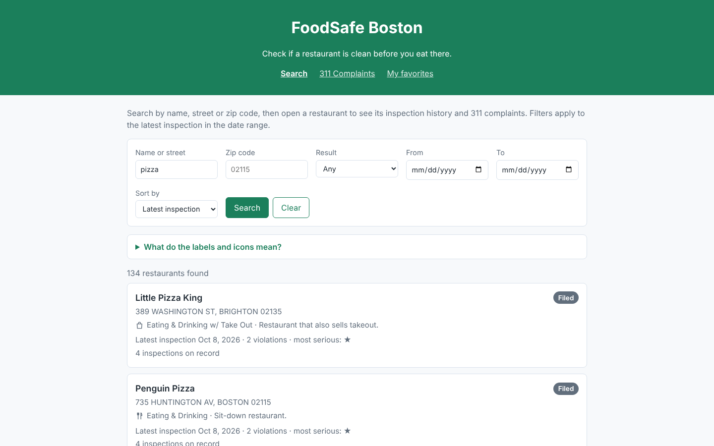
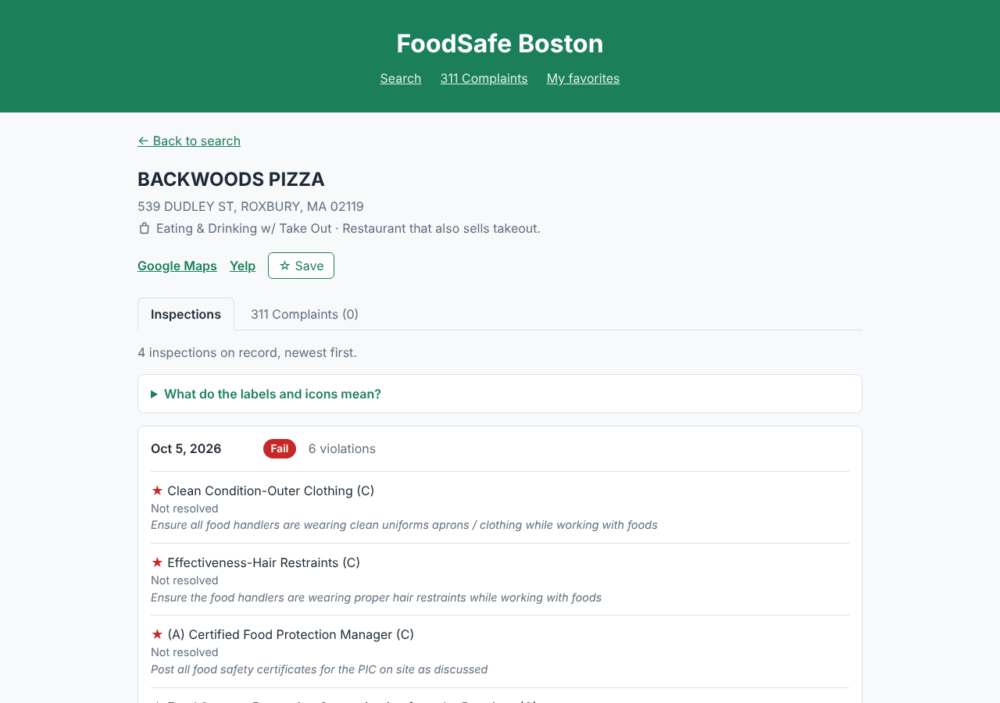
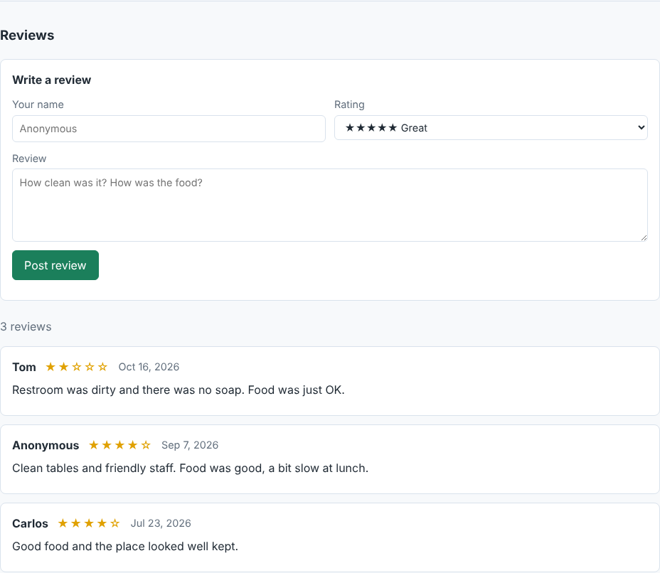
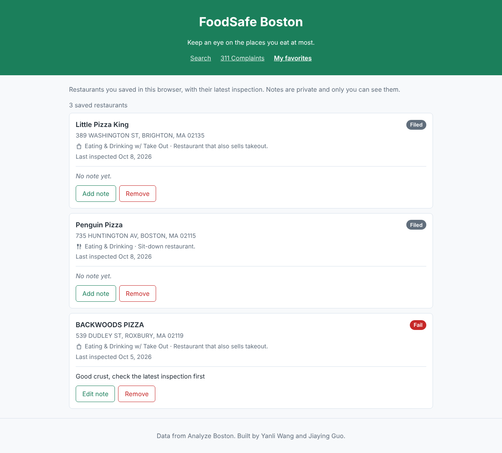
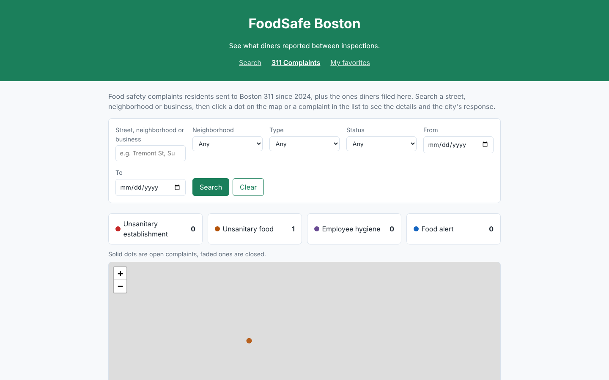
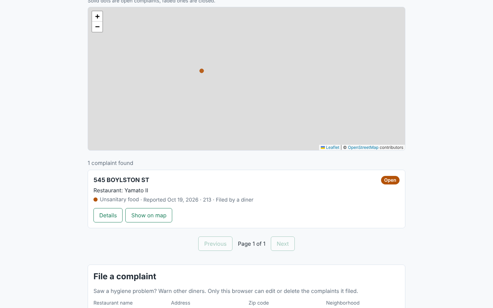
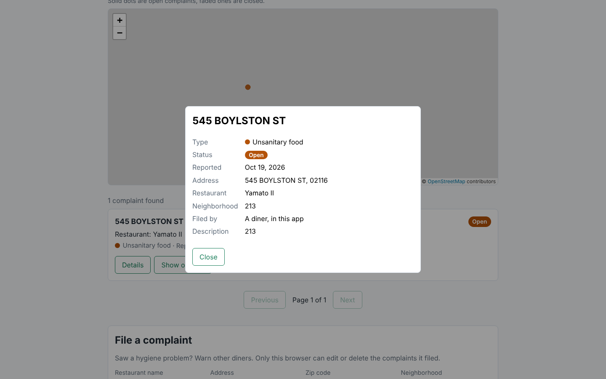
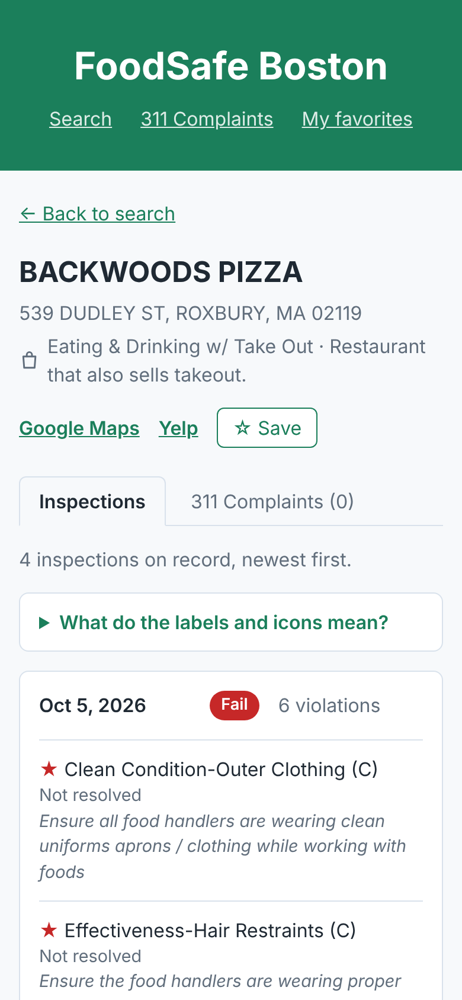

# FoodSafe Boston

Check if a restaurant is clean before you eat there.

## Authors

- Yanli Wang
- Jiaying Guo

## Class

[CS5610 Web Development, Fall 2026](https://johnguerra.co/classes/webDevelopment_online_fall_2026/), Northeastern University

## Project Objective

The City of Boston posts every restaurant health inspection online, but the dataset has more than 900,000 rows and is hard for diners to use. FoodSafe Boston lets people search a restaurant and see its latest inspection result, its past inspections and how serious each violation was, with links to Google Maps and Yelp. Diners can also leave their own reviews of a restaurant, and save the places they eat at most to see their latest results on one page. Because the city only inspects a restaurant once or twice a year, the app also maps the food safety complaints residents sent to Boston 311 between inspections, and lets diners file their own complaints.

## Features

### Inspections, reviews and favorites (Yanli Wang)

- Search restaurants by name, street or zip code, filter by zip code, latest result (Pass or Fail) and date range, and sort by latest inspection date (default) or name. Each restaurant shows up once, with its latest inspection.
- Open a restaurant to see every inspection on record, each violation, how serious it was (★ to ★★★), whether it was resolved and the inspector's comments.
- Icons show each restaurant's type (sit-down, takeout, retail or food truck), and a legend explains every result label and icon.
- Post, edit and delete reviews with a 1 to 5 star rating. There is no login, so each browser keeps a random key and can only change the reviews it wrote.
- Save restaurants to My favorites, add a private note to each, and see every saved restaurant's latest inspection result on one page. Favorites belong to the browser that saved them.

### 311 complaints (Jiaying Guo)

- Search the food safety complaints sent to Boston 311 since 2024 by street, neighborhood or business name, and filter them by neighborhood, type (unsanitary establishment, unsanitary food, employee hygiene or food alert), status (open or closed) and date range.
- See the results on a map with the number of complaints of each type. Click a dot or a complaint to see its details and the city's response.
- Boston 311 only records the address, so each complaint lists the food businesses at that address, matched by location with the city's inspection data (within 5 meters).
- File a new complaint with the restaurant name, address, neighborhood, type, date and description, and click the map to mark the place.
- Edit, mark as resolved or delete the complaints you filed. Like reviews, each browser can only change its own complaints, and the city's 311 complaints are read only.
- Each restaurant page has a 311 Complaints tab with the complaints at its address, and a link to file one.

## Screenshots

Search restaurants by name, street or zip code:



A restaurant's inspection history, with the Save button:



Reviews on a restaurant page:



My favorites, with a private note:



311 complaints, on a map and in a list, with the details of one complaint:







On a phone:



## Links

- Deployed app: <https://foodsafe-boston.onrender.com>
- Demo video: <!-- TODO -->
- Design document and mockups: [design/DesignDocument.md](design/DesignDocument.md)

## Tech Stack

- Frontend: HTML5, CSS3, vanilla JavaScript (ES6 modules, Fetch), client side rendering
- Backend: Node.js + Express (ES modules)
- Database: MongoDB with the native Node.js driver

## Data

| Collection    | Source                                                                                                             | Who can change it                 |
| ------------- | ------------------------------------------------------------------------------------------------------------------ | --------------------------------- |
| `inspections` | [Food Establishment Inspections](https://data.boston.gov/dataset/food-establishment-inspections), 2026 inspections | Read only, loaded by the import   |
| `reviews`     | Written by users in the app                                                                                        | The browser that wrote the review |
| `favorites`   | Saved by users in the app, private to each browser                                                                 | The browser that saved it         |
| `complaints`  | [311 Service Requests](https://data.boston.gov/dataset/311-service-requests) since 2024, and diners                | Filer's browser; 311 is read only |

## API

| Method | Path                                                     | Description                                                                                        |
| ------ | -------------------------------------------------------- | -------------------------------------------------------------------------------------------------- |
| GET    | `/api/inspections?q=&zip=&result=&from=&to=&sort=&page=` | Search restaurants, one result per restaurant, newest inspection first, or A to Z with `sort=name` |
| GET    | `/api/inspections/restaurant/:licenseNo`                 | All inspections for one restaurant, newest first                                                   |
| GET    | `/api/reviews?license=`                                  | Reviews for one restaurant                                                                         |
| POST   | `/api/reviews`                                           | Add a review                                                                                       |
| PUT    | `/api/reviews/:id`                                       | Edit your review                                                                                   |
| DELETE | `/api/reviews/:id`                                       | Delete your review                                                                                 |
| GET    | `/api/favorites?license=`                                | Your saved restaurants with their latest inspection, or check one restaurant with `license`        |
| POST   | `/api/favorites`                                         | Save a restaurant                                                                                  |
| PUT    | `/api/favorites/:id`                                     | Edit the note on a saved restaurant                                                                |
| DELETE | `/api/favorites/:id`                                     | Remove a saved restaurant                                                                          |
| GET    | `/api/complaints?q=&neighborhood=&type=&status=&page=`   | Search complaints, newest first, with the count of each type. Also takes `from` and `to`           |
| GET    | `/api/complaints?address=&zip=`                          | Complaints at one restaurant's address                                                             |
| GET    | `/api/complaints/map`                                    | Every matching complaint for the map, same filters as above                                        |
| GET    | `/api/complaints/neighborhoods`                          | Neighborhood names for the filter                                                                  |
| GET    | `/api/complaints/:id`                                    | One complaint with the city's response                                                             |
| POST   | `/api/complaints`                                        | File a complaint                                                                                   |
| PUT    | `/api/complaints/:id`                                    | Edit your complaint                                                                                |
| PATCH  | `/api/complaints/:id`                                    | Mark your complaint as resolved (`status: "Closed"`) or open it again                              |
| DELETE | `/api/complaints/:id`                                    | Delete your complaint                                                                              |

## Instructions to Build

1. Install Node.js 20 or newer.
2. Install dependencies:
   ```bash
   npm install
   ```
3. Copy `.env.example` to `.env` and set `MONGO_URI` to your MongoDB connection string.
4. Import the inspection data. Download the CSV from [Food Establishment Inspections](https://data.boston.gov/dataset/food-establishment-inspections), save it as `data/inspections.csv`, then run:
   ```bash
   npm run import:inspections
   ```
   This loads the 2026 inspections. Re-running it replaces the imported data and keeps reviews and favorites.
5. Import the 311 complaints. This downloads them from the Analyze Boston API, so there is no file to save:
   ```bash
   npm run import:complaints
   ```
   This loads the food safety complaints from 2024 to now. Re-running it replaces the 311 data and keeps complaints filed in the app.
6. (Optional) Add sample reviews to 100 random restaurants:
   ```bash
   npm run seed:reviews
   ```
   Re-running it replaces the old sample reviews and keeps reviews written in the app.
7. Start the server:
   ```bash
   npm start
   ```
8. Open http://localhost:3000.

## Project Structure

```
server.js        Express app entry point
db/              MongoDB connection module
routes/          API routes (inspections, reviews, favorites, complaints)
scripts/         Data import scripts
frontend/        Static HTML pages, CSS modules and client JS
design/          Design document and mockups
```

## License

[MIT](LICENSE)
