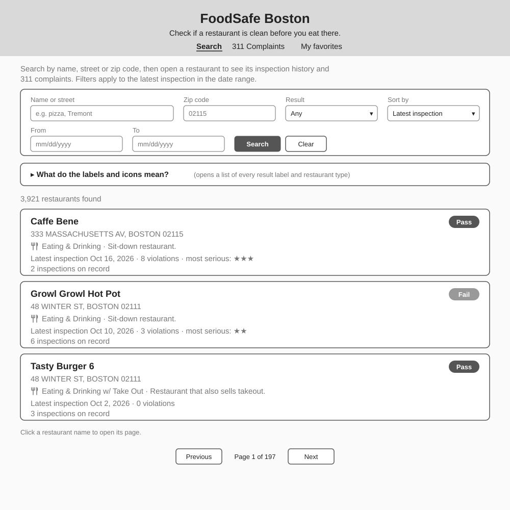
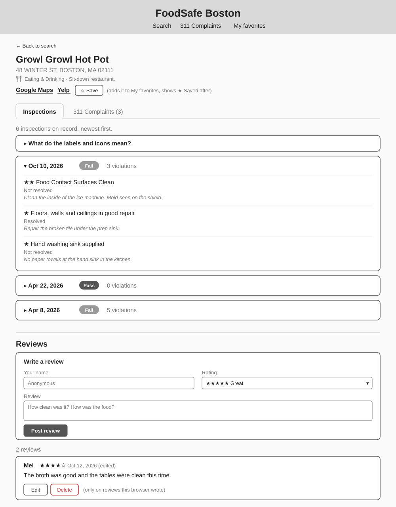
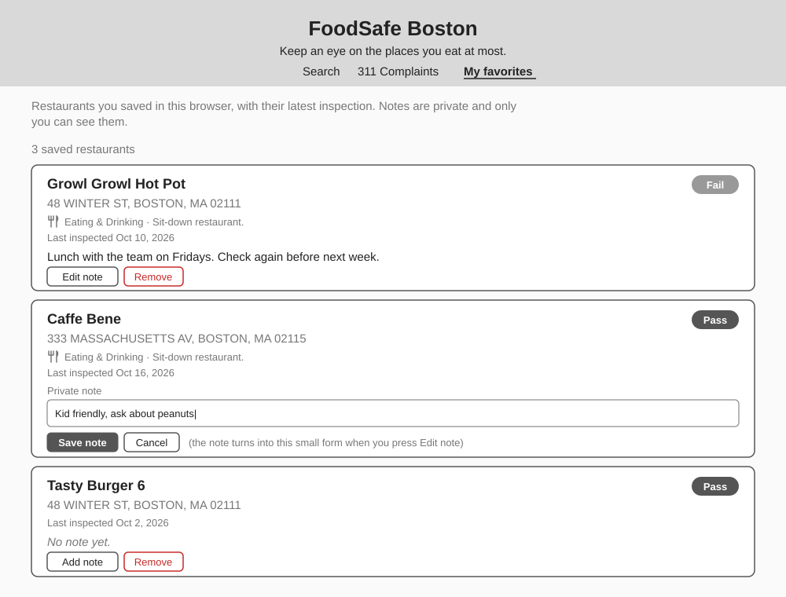
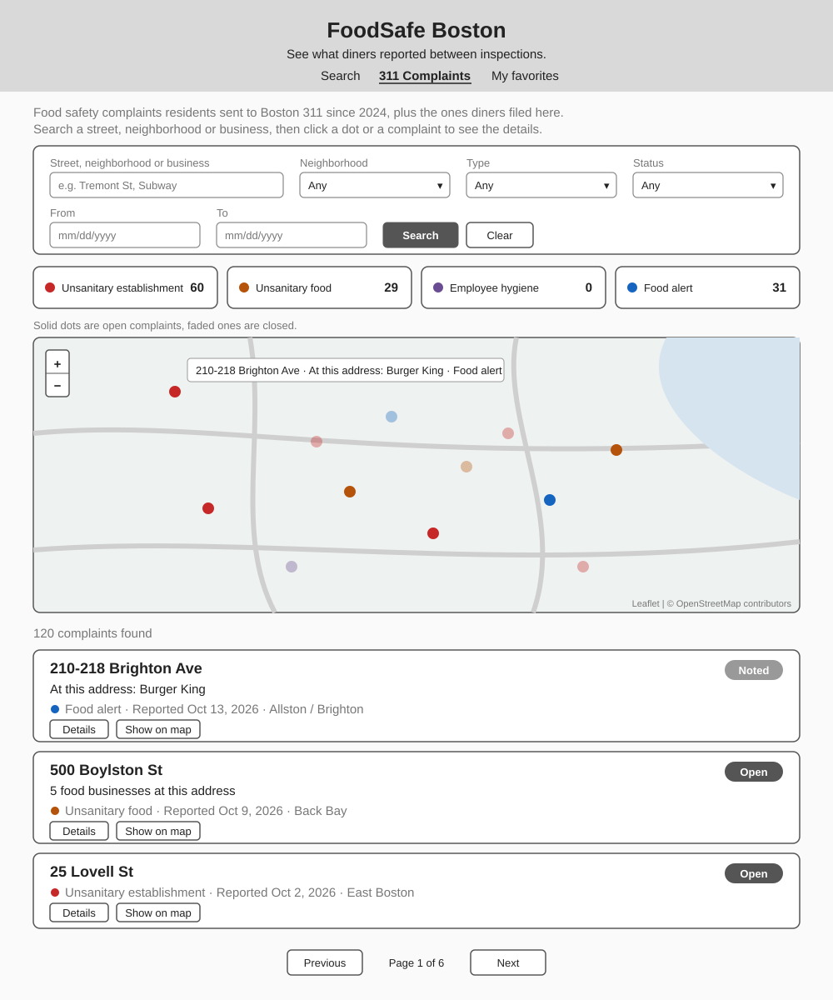
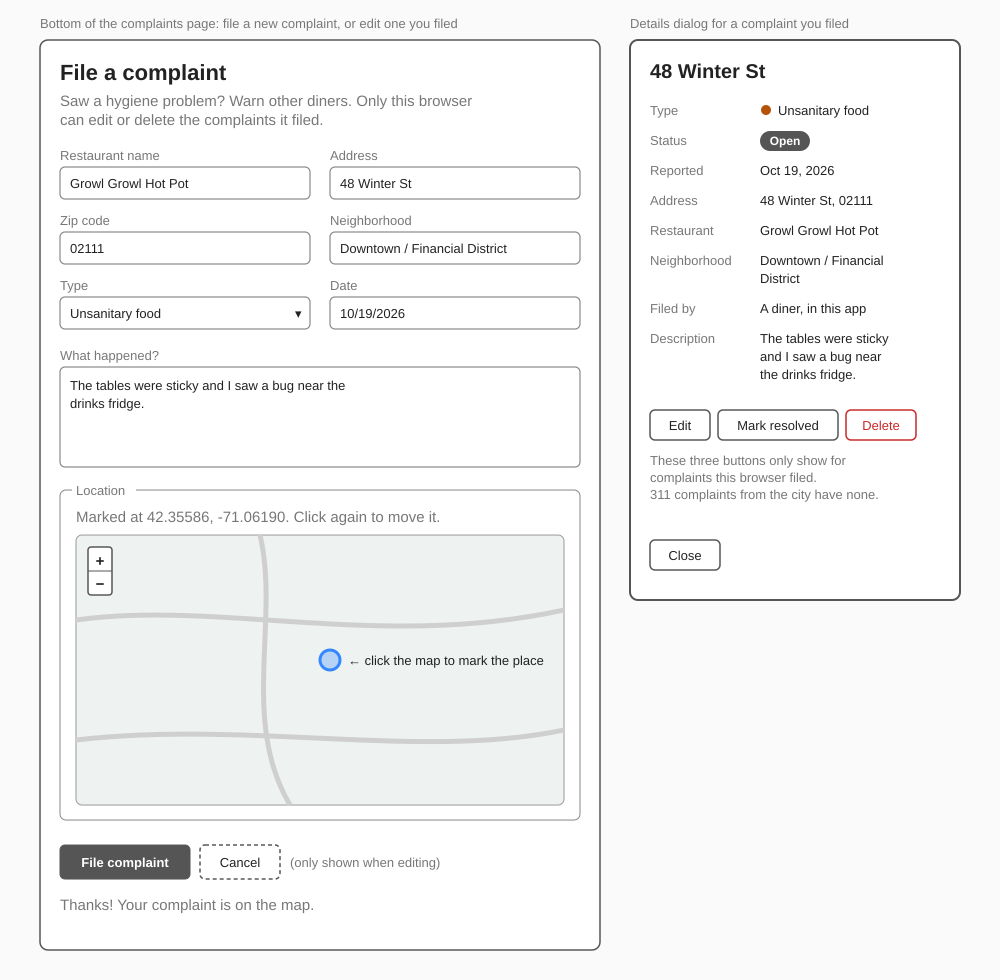
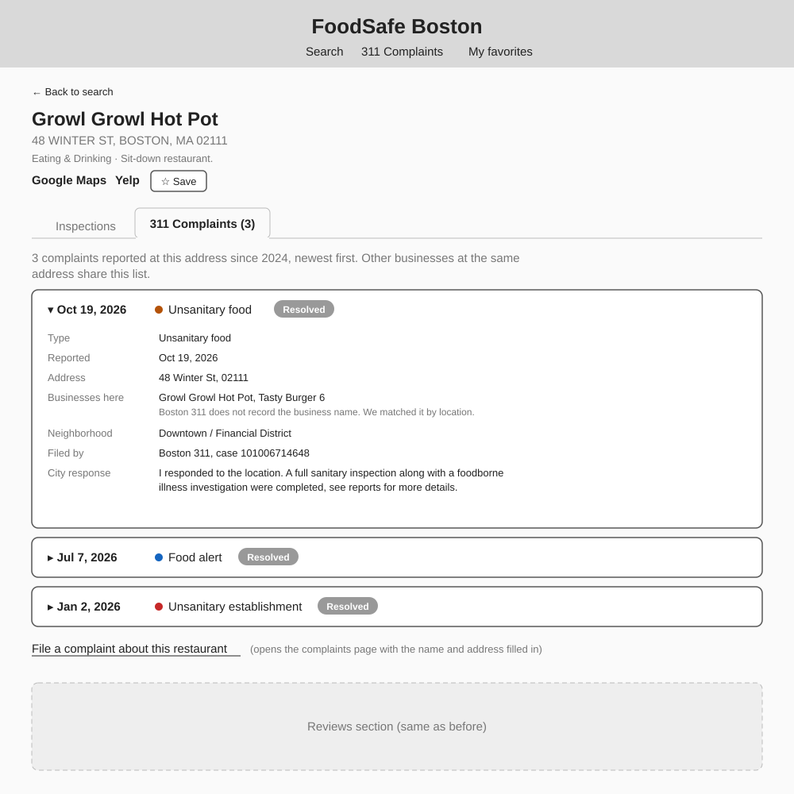

# FoodSafe Boston Design Document

Team: Yanli Wang and Jiaying Guo

Class: [CS5610 Web Development, Fall 2026](https://johnguerra.co/classes/webDevelopment_online_fall_2026/), Northeastern University

## Project Description

FoodSafe Boston helps people check if a restaurant is clean before they eat there.

The City of Boston posts all restaurant health inspection results online, but the dataset has more than 900,000 rows and it is very hard for normal diners to use. In our app people can search a restaurant and see its latest inspection result, the past inspections and how serious each violation was, with links to the restaurant on Google Maps and Yelp. Diners can write reviews about a restaurant, and save the places they go often to see all their latest results on one page.

The city only inspects a restaurant once or twice a year. Between inspections, residents send food safety complaints to Boston 311. We show these complaints on a map, together with the number of complaints of each type and the city's response. Boston 311 only saves the address of a complaint, not the business name, so we match each complaint with the food businesses at the same location. Diners can also file their own complaints to warn other people.

We think this is useful for students, parents and people with food allergies who want to check a place before they go.

## User Personas

**Mei**, 25, a grad student at Northeastern. She eats out four or five times a week near campus and downtown. She wants to avoid places with serious violations, and she likes to read what other diners say.

**Daniel**, 38, a father of a toddler with a peanut allergy. Before a family dinner he always checks the restaurant. He cares about recent problems in his neighborhood, not only the last inspection, and he wants to know if the city fixed them.

**Ana**, 30, a nurse who lives in Dorchester. When she sees a hygiene problem in a restaurant she wants to tell other people, but she does not want to call the city or make an account somewhere.

**Lucas**, 33, an office worker in the Financial District. He eats lunch at the same few places every week. He wants to see all of them in one place and know quickly if one of them fails an inspection.

## User Stories

### Yanli Wang: inspections, reviews and favorites

1. As Mei, I want to search restaurants by name, street or zip code, so I can see their latest inspection result.
2. As Mei, I want to see a restaurant's inspection history with every violation, its level (the city uses 1 to 3 stars) and the inspector comments, plus links to Google Maps and Yelp, so I can know how serious the problems are and compare with public reviews.
3. As Daniel, I want to filter restaurants by zip code, result (pass or fail) and date range, and sort them by date or name, so I can find clean places near me.
4. As Mei, I want to post a review with a 1 to 5 star rating, and edit or delete my own reviews, so I can share what I saw with other diners.
5. As Lucas, I want to save restaurants to my favorites with a private note, edit the note or remove a restaurant, and see the latest result of all my saved places on one page, so I notice fast when one of them fails.

### Jiaying Guo: 311 complaints

6. As Daniel, I want to search complaints by street, neighborhood or business name and filter them by neighborhood, type, status (open or closed) and date range, so I can find recent problems near me.
7. As Daniel, I want to see the results on a map with the number of complaints of each type, and click one to see its details, the businesses at that address and the city's response, so I can know which areas have more problems and if a problem was fixed.
8. As Ana, I want to file a new complaint with the restaurant name, address, neighborhood, type, date and description, and click the map to mark the place, so I can warn other diners.
9. As Ana, I want to edit, mark as resolved or delete a complaint I filed, so I can keep the information correct.
10. As Mei, I want to see the 311 complaints at a restaurant's address on the restaurant page, and file a complaint from there with the name and address already filled in, so I don't need to search two times.

## Changes From the Proposal

- In the proposal, Raj (a volunteer) could add, edit and delete inspection records. We decided that users should not change the official city data, so the inspections are now read only. Instead, users create their own data: reviews, favorites and complaints. Each of these supports create, read, update and delete.
- There is no login. Each browser keeps a random key, and only that browser can change the reviews, favorites and complaints it made. The complaints imported from Boston 311 are read only.
- Boston 311 does not save the business name, so the import also reads the city's inspection data and lists the food businesses within 5 meters of each complaint. About 70% of the complaints get at least one business. The app says "at this address" and not "this restaurant", because we can't be sure which business the complaint is about.
- The restaurant page now has a 311 Complaints tab, so the two parts of the app are connected for the user. In the database they still don't depend on each other: complaints save the address as text and are matched with the address and zip code.

## Design Mockups

All pages share the same header with three links: Search, 311 Complaints and My favorites.

### Yanli Wang: inspections, reviews and favorites

#### Search page (stories 1 and 3)

The search form is on top, with filters for zip code, result and date range and a sort option. Each restaurant shows up one time with its latest inspection: the result label, the address, an icon for the restaurant type, how many violations and the most serious level. A legend explains every label and icon. Clicking a name opens the restaurant page.

#### Restaurant page (stories 2 and 4)

The top shows the name, address, type, links to Google Maps and Yelp, and a Save button for favorites. The Inspections tab lists every inspection, newest first. Each one opens to show its violations with the level in stars, if it was resolved, and the inspector comments. Under the tabs there is the review form and the list of reviews. Edit and Delete only show on reviews written in this browser.

#### My favorites (story 5)

Each saved restaurant shows its latest result and when it was last inspected, so the user can check all of them at once. The private note can be added or edited in place, and Remove takes the restaurant off the list.

### Jiaying Guo: 311 complaints

#### Complaints page (stories 6 and 7)

The filters are on top. Under them are the counts of each type, the map and the list. On the map, solid dots are open complaints and faded dots are closed. The list shows the address as the title, the businesses at that address under it, and the type, date and neighborhood.

#### Complaint form and details (stories 8 and 9)

The form is at the bottom of the complaints page. The user clicks the small map to mark the place. When the user edits a complaint, the same form is filled in and a Cancel button shows. The details dialog has Edit, Mark resolved and Delete buttons only for complaints filed in this browser.

#### 311 Complaints tab on the restaurant page (story 10)

The tab shows how many complaints there are at the restaurant's address. Each complaint opens to show its details. The link under the list opens the complaints page with the restaurant name and address already in the form.

## Data

We use MongoDB with four collections.

| Collection    | Where the data comes from                                                             | Main fields                                                                                                                                      |
| ------------- | ------------------------------------------------------------------------------------- | ------------------------------------------------------------------------------------------------------------------------------------------------ |
| `inspections` | Food Establishment Inspections from Analyze Boston, 2026, about 10,000 records        | restaurantName, licenseNo, address, zip, type, result, date, violations                                                                          |
| `reviews`     | Users                                                                                 | licenseNo, author, rating, text, createdAt                                                                                                       |
| `favorites`   | Users                                                                                 | licenseNo, note, createdAt                                                                                                                       |
| `complaints`  | 311 Service Requests from Analyze Boston, 2024 to now, about 3,400 records, and users | type, status, openedAt, closedAt, outcome, response, address, zip, neighborhood, location, nearbyBusinesses, restaurantName, description, source |

## Tech Stack

- Frontend: HTML5, CSS3, vanilla JavaScript with ES6 modules and Fetch, client side rendering
- Backend: Node.js and Express with ES modules
- Database: MongoDB with the native Node.js driver
- Map: Leaflet with free OpenStreetMap tiles (approved by the professor)
